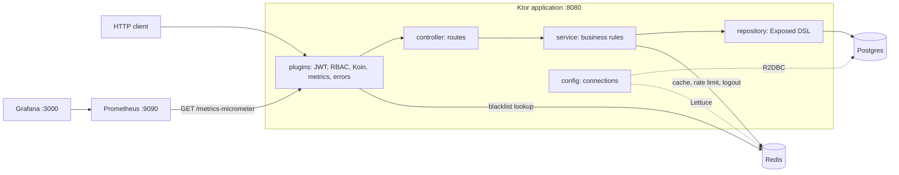

# ktor-crud-rbac-demo

A learning project in Kotlin and Ktor: a small pizza-ordering REST API with JWT authentication, role-based access control, Postgres through Exposed's R2DBC driver, Redis for caching, token revocation and rate limiting, and Prometheus and Grafana for metrics.

[](https://github.com/Fede-Berga/ktor-crud-rbac-demo/actions/workflows/ci.yml)
[](gradle/libs.versions.toml)
[](LICENSE)

## Quick start

Prerequisites: Docker with Compose v2, a JDK 17 or newer to run Gradle 9.5 (the build compiles with a JDK 21 toolchain, which Gradle downloads if none is installed), and `curl` and `jq` for the examples.

```bash
docker compose up -d   # Postgres, Redis, Prometheus, Grafana
./gradlew run          # API on http://localhost:8080
```

On first start, if the `users` table is empty, the application creates two local demo accounts with bcrypt-hashed passwords:

| Username | Password | Role |
| --- | --- | --- |
| `admin` | `admin123` | `ADMIN` |
| `alice` | `alice123` | `USER` |

Log in, then call the API with the token:

```bash
ALICE=$(curl -s -X POST localhost:8080/auth/login -H 'Content-Type: application/json' \
  -d '{"username":"alice","password":"alice123"}' | jq -r .token)
curl -s localhost:8080/pizzas -H "Authorization: Bearer $ALICE"   # [] on a fresh database

# Only ADMIN may change the menu: alice gets 403, admin gets 201
PIZZA='{"name":"Margherita","ingredients":"tomato, mozzarella","priceCents":900}'
curl -s -X POST localhost:8080/pizzas -H "Authorization: Bearer $ALICE" \
  -H 'Content-Type: application/json' -d "$PIZZA"   # {"error":"Requires role ADMIN"}
ADMIN=$(curl -s -X POST localhost:8080/auth/login -H 'Content-Type: application/json' \
  -d '{"username":"admin","password":"admin123"}' | jq -r .token)
PIZZA_ID=$(curl -s -X POST localhost:8080/pizzas -H "Authorization: Bearer $ADMIN" \
  -H 'Content-Type: application/json' -d "$PIZZA" | jq .id)

# alice orders it; GET /orders returns only her orders, but every order for admin
curl -s -X POST localhost:8080/orders -H "Authorization: Bearer $ALICE" \
  -H 'Content-Type: application/json' -d "{\"pizzaId\":$PIZZA_ID,\"quantity\":2}"
curl -s localhost:8080/orders -H "Authorization: Bearer $ALICE"
curl -s localhost:8080/orders -H "Authorization: Bearer $ADMIN"

# Logout revokes the token immediately
curl -s -X POST localhost:8080/auth/logout -H "Authorization: Bearer $ALICE"
curl -s -o /dev/null -w '%{http_code}\n' localhost:8080/pizzas -H "Authorization: Bearer $ALICE"   # 401
```

## API

| Method | Path | Who may call it |
| --- | --- | --- |
| `POST` | `/auth/login` | anyone, rate limited |
| `POST` | `/auth/logout` | any valid token |
| `GET` | `/pizzas` | `USER`, `ADMIN` |
| `GET` | `/pizzas/{id}` | `USER`, `ADMIN` |
| `POST` | `/pizzas` | `ADMIN` |
| `PUT` | `/pizzas/{id}` | `ADMIN` |
| `DELETE` | `/pizzas/{id}` | `ADMIN` |
| `POST` | `/orders` | `USER`, `ADMIN`; the order belongs to the caller |
| `GET` | `/orders` | `USER` gets their own orders, `ADMIN` gets all |
| `GET` | `/orders/{id}` | the order's owner or `ADMIN` |
| `DELETE` | `/orders/{id}` | the order's owner or `ADMIN` |
| `GET` | `/metrics-micrometer` | anyone (Prometheus text format) |

Bodies are JSON: `{"username", "password"}` for login, which returns `{"token"}`; `{"name", "ingredients", "priceCents"}` for pizzas; `{"pizzaId", "quantity"}` for orders, which are created as `PENDING`. A missing, invalid, expired or revoked token gets an empty 401 from the JWT plugin. Other errors come from `StatusPages` as `{"error": "..."}`: 401 for wrong credentials, 403 for a missing role or someone else's order, 404 for an unknown or non-numeric id, 429 from the rate limiter.

## Architecture

The stack is Ktor 3.5 on Netty, Exposed 1.3 (DSL over R2DBC), Lettuce's coroutine API for Redis, Koin, auth0 java-jwt, bcrypt and Micrometer. The packages under `src/main/kotlin/com/example/com/` form layers:

- `config` connects to Postgres through R2DBC, creating the tables with `SchemaUtils.create`, and to Redis through Lettuce.
- `plugins` installs JSON content negotiation, `StatusPages`, Micrometer, JWT authentication and Koin, and defines `roleProtected`, the per-route role check.
- `repository` runs Exposed DSL queries inside `suspendTransaction`.
- `service` holds the business rules, the menu cache, the rate limiter and logout.
- `controller` declares the routes and calls only services.
- `domain` (Exposed tables and models), `dto` (`toDomain()` on request classes, `toResponse()` on domain models) and `common` (exceptions) are shared.

[Application.kt](src/main/kotlin/com/example/com/Application.kt) defines the startup order: serialization, status pages, metrics, database, Redis, JWT security, Koin, routes, then the demo users.



## Three uses of Redis

1. **Cache-aside for the menu.** `GET /pizzas` reads `pizza:all` and `GET /pizzas/{id}` reads `pizza:<id>`. On a miss the service queries Postgres and stores the JSON for 60 seconds. Creating a pizza deletes `pizza:all`; updating or deleting one deletes `pizza:all` and `pizza:<id>`.
2. **JWT blacklist.** Tokens are HMAC-SHA256 JWTs valid for 15 minutes, each with a unique `jti`. `POST /auth/logout` stores `jwt:blacklist:<jti>` with `SETEX` for the token's remaining lifetime, and the JWT `validate` block rejects any token on that list.
3. **Login rate limit.** Every login attempt increments `ratelimit:login:<remote host>`, and the first increment sets a 60-second expiry. From the sixth attempt in that window the API answers 429, whether the credentials are right or not.

To look at the cache keys: `docker compose exec redis redis-cli KEYS 'pizza:*'`.

## Observability

`GET /metrics-micrometer` exports Ktor's request timer (`ktor_http_server_requests_seconds`, with 0.5, 0.9, 0.95 and 0.99 quantiles), JVM class loader, memory, GC and thread metrics, processor, file descriptor and uptime metrics, and three application counters: `pizza_orders_created_total`, `pizza_cache_requests_total{result="hit"|"miss"}` and `auth_login_rate_limited_total`.

Prometheus ([localhost:9090](http://localhost:9090)) scrapes `host.docker.internal:8080` every 5 seconds; the API itself runs on the host, not in Compose. Grafana ([localhost:3000](http://localhost:3000)) allows anonymous access with the Admin role and provisions the Prometheus data source and a "Pizza Orders — Overview" dashboard: request rate by route and method, p95 latency, JVM heap, cache hit ratio, orders created and rate-limited logins. The configuration is in [observability/](observability/).

## Running the tests

```bash
docker compose up -d --wait postgres redis
./gradlew test
```

[ServerTest](src/test/kotlin/com/example/com/ServerTest.kt) has five integration tests that start the application with `testApplication` and the real `application.yaml`: login and menu access, `ADMIN`-only pizza creation, order visibility, token revocation and the rate limiter. They need Postgres on `localhost:5432` and Redis on `localhost:6379`; there are no tests that run without them. Each test runs `FLUSHALL` on Redis before and after, and the pizzas and orders it creates stay in the `pizzadb` database that `./gradlew run` uses.

CI runs `./gradlew build` on JDK 21 against Postgres and Redis service containers that match `docker-compose.yml`.

## Design decisions and limitations

- **Layers, not feature modules.** Routes call services, services call repositories and Redis, and Koin wires them as singletons. Routes never touch Exposed or Redis directly.
- **Non-blocking I/O.** Exposed's R2DBC driver and Lettuce's coroutine API (still experimental, hence the `@OptIn` annotations) make database and Redis calls suspend instead of blocking request threads.
- **Authorization in two places.** `roleProtected` checks the JWT `role` claim per route, so a role change only applies to tokens issued afterwards; order ownership is checked in `OrderService`.
- **Revocable JWTs.** The blacklist makes logout immediate at the cost of one Redis `GET` per authenticated request. There are no refresh tokens.
- **Simple rate limiter.** A fixed window keyed by the connection's remote host. Forwarded headers are not read, so behind a reverse proxy all clients would share one counter.

This is not production software. The schema comes from `SchemaUtils.create`, with no migrations. Database credentials, the Redis URL and a placeholder JWT secret are hard-coded in [application.yaml](src/main/resources/application.yaml) with no environment overrides. Request bodies are not validated beyond their JSON types, orders stay `PENDING` because no endpoint changes their status, and Prometheus and Grafana run unpinned `latest` images.

## License

[MIT](LICENSE)
